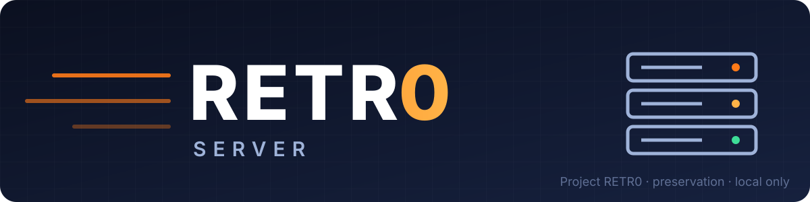
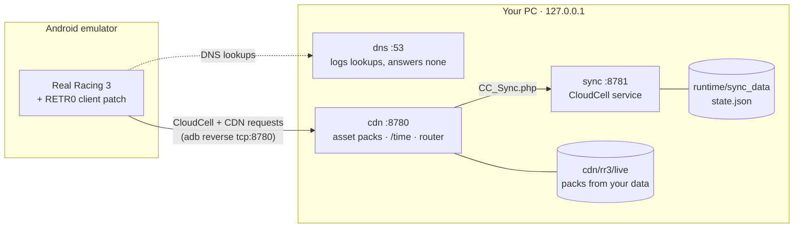

<p align="center">
  
</p>

<p align="center">
  <a href="https://github.com/Tankonline/RETR0-Server/actions/workflows/ci.yml"></a>
  <a href="LICENSE"></a>
  <a href="LICENSE-DOCS.md"></a>
  
  
  
</p>

<p align="center">
  <b>An independent, local replacement server for Real Racing 3 after its official services shut down on 20 March 2026.</b><br>
  Built by reverse engineering the Android client: no EA code, no game assets, no keys.
</p>

<p align="center">
  <a href="docs/08-setup-guide.md"><b>Setup guide</b></a> ·
  <a href="docs/README.md"><b>Documentation</b></a> ·
  <a href="docs/06-network-protocol.md"><b>Protocol</b></a> ·
  <a href="https://github.com/Tankonline/RETR0-Client"><b>RETR0 Client</b></a> ·
  <a href="CHANGELOG.md"><b>Changelog</b></a>
</p>

---

## Why this exists

When Real Racing 3's online services were switched off, the game stopped being fully playable: a **fresh install can't
download its ~1.5 GB of content**, the game shows **OFFLINE**, and online-gated screens (special events, the store) stay
locked. **Project RETR0** studied the client in detail and rebuilt the missing server side so one player can run it on
their own PC, from their own copy of the game.

## At a glance

| | |
|---|---|
| **Runs on** | Windows PC + Android emulator (x86_64, Android 14), all traffic on `127.0.0.1` |
| **Stack** | Python 3 (standard library only), PowerShell control script |
| **Serves** | Asset CDN (HTTP Range, rebuilt from *your* data) · `/time` · CloudCell `CC_Sync.php` |
| **Client** | [RETR0-Client](https://github.com/Tankonline/RETR0-Client) builds a patched client from your own APK |
| **Tests** | 59 unit tests, run on every push |
| **Docs** | 13-chapter guide + feature pages + the full reference set (every finding with evidence) |

## How it fits together



## What works

| Feature | Status | Docs |
|---|:---:|---|
| Asset downloads for a fresh install | ✅ Working | [Asset CDN](docs/09-asset-cdn.md) |
| CloudCell sync: the game shows online | ✅ Working | [Server](docs/07-server.md) · [Protocol](docs/06-network-protocol.md) |
| Built-in server redirect (no Frida) | ✅ Working | [Server redirect](https://github.com/Tankonline/RETR0-Client/blob/main/docs/features/server-redirect.md) |
| Grand Prix / Special Events | ✅ Working | [Special events](https://github.com/Tankonline/RETR0-Client/blob/main/docs/features/special-events.md) |
| Store BUY gives currency (free preservation grant) | ✅ Working | [Store grants](https://github.com/Tankonline/RETR0-Client/blob/main/docs/features/store-grants.md) |
| Choose your player name instead of "Guest" | ✅ Working | [Username](https://github.com/Tankonline/RETR0-Client/blob/main/docs/features/username.md) |
| Server-side gifts (Gold, R$, M$, custom amounts, cars) | ✅ Working | [Gifts](docs/features/gifts.md) |
| Control panel (`RETR0 Server.exe`) | ✅ Working | [server/tools/control_panel](server/tools/control_panel/) |
| Leaderboards · race teams · multiplayer | 🗺️ Planned | [Roadmap](docs/12-known-issues-and-roadmap.md) |

## Quick start

> Full walkthrough: **[docs/08-setup-guide.md](docs/08-setup-guide.md)**. You need your own RR3 14.0.1 APK and game data.

```powershell
# one-time
py -3 -m venv server\python
copy <your .depot>\CC_SeedData.bin server\data\
# build asset packs from your own data, and the RETR0 client with the RETR0-Client repo (see the guide)

# every session
server\retr0_server.cmd start -WithSync
server\play.cmd
```

## Documentation

| Start here | Go deeper |
|---|---|
| [01 · Project overview](docs/01-project-overview.md) | [04 · How the game was decompiled](docs/04-decompilation-method.md) |
| [02 · Timeline of everything we did](docs/02-timeline.md) | [05 · Client architecture](docs/05-client-architecture.md) |
| [07 · The server](docs/07-server.md) | [06 · Network protocol](docs/06-network-protocol.md) |
| [08 · Setup guide](docs/08-setup-guide.md) | [09 · Asset CDN](docs/09-asset-cdn.md) |
| [12 · Known issues and roadmap](docs/12-known-issues-and-roadmap.md) | [Reference set: every finding with evidence](docs/reference/README.md) |

## Repository layout

```
server/          control scripts, services (dns, cdn/recorder, CloudCell sync), codec, config, pack tools
research-tools/  emulator network lock, Frida hooks, session runner (used during the research)
tests/           unit tests for the codec and the sync service
docs/            guide, feature pages, reference set
```

## FAQ

<details>
<summary><b>Does this contain the game, an APK, or EA's servers?</b></summary>

No. It contains only independently written code and documentation. You need your own legitimately obtained copy of
Real Racing 3 14.0.1 and its data. Nothing here contacts EA's infrastructure.
</details>

<details>
<summary><b>Does it work on a real phone?</b></summary>

It was built and tested on an Android emulator. The client redirect currently targets `127.0.0.1:8780` via
`adb reverse`; making the address configurable for a phone on the same network is on the
[roadmap](docs/12-known-issues-and-roadmap.md).
</details>

<details>
<summary><b>Is the store feature a purchase bypass?</b></summary>

No purchases are possible any more. The feature grants currency through the game's own *non-purchase* reward path. It
fakes no receipts, makes no billing calls and records no purchase. See
[store grants](https://github.com/Tankonline/RETR0-Client/blob/main/docs/features/store-grants.md).
</details>

<details>
<summary><b>How do I contribute?</b></summary>

See [CONTRIBUTING.md](CONTRIBUTING.md). Findings need evidence and a confidence label; code needs tests.
</details>

## Legal

Code is [MIT](LICENSE); documentation is [CC BY 4.0](LICENSE-DOCS.md). Read the [disclaimer](DISCLAIMER.md).
Real Racing 3 is a trademark of Electronic Arts Inc. This project is not affiliated with or endorsed by EA, Firemonkeys
or Glu.
