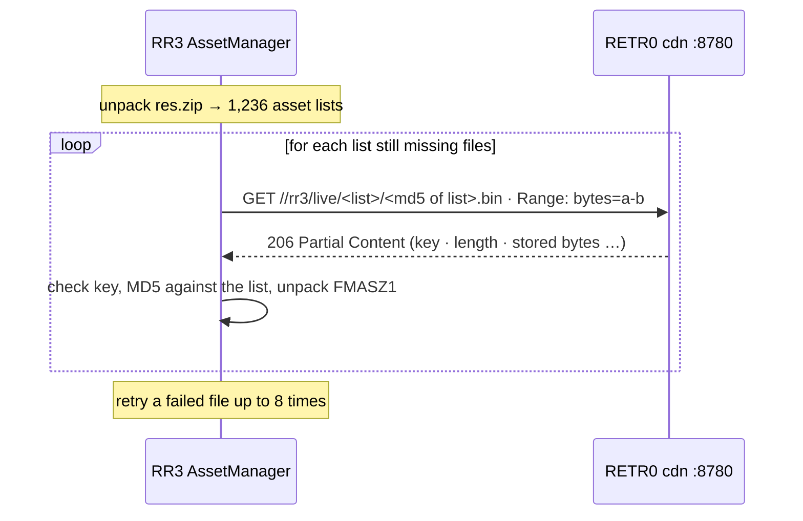

# 09 · The asset CDN

A fresh install must download ~1 GB of content before it can be played. This chapter explains the download
protocol, how the server rebuilds the CDN from your own data, and why "edited lists" exist. Evidence:
[reference/ASSET_DOWNLOAD_PROTOCOL.md](reference/ASSET_DOWNLOAD_PROTOCOL.md) (AD-01..AD-11).

## 1. How the game downloads

1. First launch unpacks `res.zip` from the APK into `files/apk/`. It contains **1,236 asset lists**, one line per
   file: `/path<TAB>md5<TAB>stored size<TAB>uncompressed size`.
2. For each list the game requests a pack from the CDN:
   `https://firemonkeys.akamaized.net//rr3/live/<list name>/<MD5 of the list file>.bin`.
3. It downloads **byte ranges**: neighbouring entries batched up to 512 KB, big files in equal parts.
4. It checks every file's **MD5 against the list**, unpacks compressed files, and retries a failed file up to 8
   times.



## 2. Pack format

```
pack      = for every list line, in list order:  u32 key · u32 length · stored bytes
key       = djb2(path) mod 0x106d643d          h = 5381; for each byte c (signed): h = h*33 + c   (32-bit)
stored    = the file itself, or "FMASZ1" + zlib(file)  (classic zlib, default level 6)
```

The model was verified on real traffic: **285 of 285** recorded byte ranges and **1,129 of 1,129** recorded keys
match, and **445 of 445** compressed files rebuild byte-identically from the owner's data.

Code: list parser `0x1cd3a54`, downloader `0x1cd691c`, data callback `0x1cd96fc`, key hash `0x1cd0c00`, MD5 check
`0x1cdc7ac`, `FMASZ1` unpacking `0x1cdd760`.

## 3. Building the packs

[`server/tools/asset_pack_build.py`](../server/tools/asset_pack_build.py) writes one pack per list from your
`.depot` folder(s), named by the list's MD5, and the server serves them from `server/cdn/rr3/live/` with HTTP
Range (206). Classic zlib (MSYS2 `zlib1.dll`) is used so the compressed bytes match the original MD5s.

## 4. Why "edited lists"

The game accepts a file only if its MD5 matches the list exactly. Some originals are missing from every copy of the
data the project had: ~1,767 ETC textures (replaced by `.rgb.pvr.z` versions), some limited-time GUI art,
low-detail track variants, and a few files changed by later updates. So, **for a test device**:

- `asset_pack_build.py --drop-unavailable` writes **edited lists** without the entries it can't reproduce
  byte-exactly, and builds packs from those lists (their names change to the edited lists' MD5s).
- The game re-extracts `files/apk/res.zip` at **every** launch and replaces it from the APK whenever its **length**
  differs. So the edited lists go into an edited `res.zip` padded to exactly the original length
  ([`make_edited_res_zip.py`](../server/tools/make_edited_res_zip.py)).
- [`apply_edited_lists.py`](../server/tools/apply_edited_lists.py) adds your RGB versions of the dropped ETC
  textures, which is what a normal install ended up using anyway.

Result (run 9): the full download completes with **0 errors**. The game simply doesn't have the dropped files.

## 5. Serving modified files

`asset_pack_build.py --modified-data <folder>` takes your changed files at their `.depot`-relative paths; each one
that differs from the original replaces it in the pack, and the edited list carries its own MD5 and sizes, so the
game accepts it. Tested on a plain and a compressed file (runs 14–15).

## 6. Not needed: the pack-hash endpoint

When a CDN request fails, the game falls back to `POST //assetman/assetManDownloadPackHash.php` on the asset
server. Its request format is known (AD-09); its reply format is not. With the CDN answering, the fallback is never
used.
